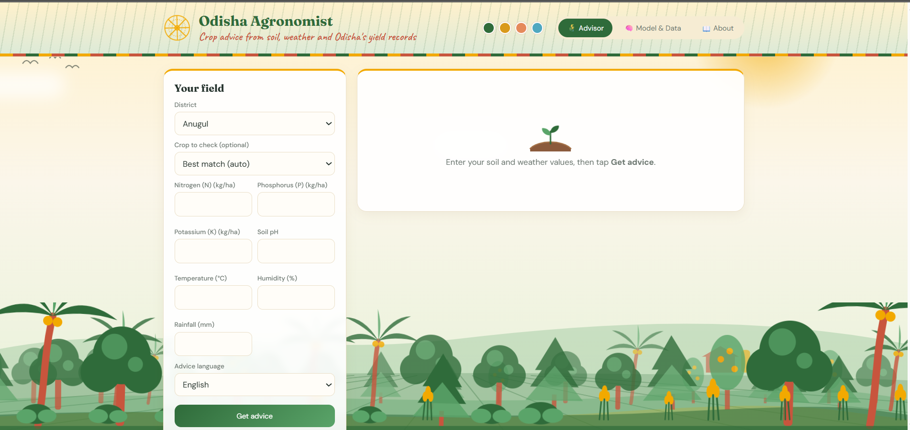
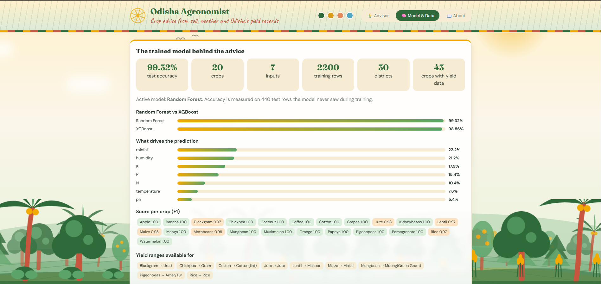
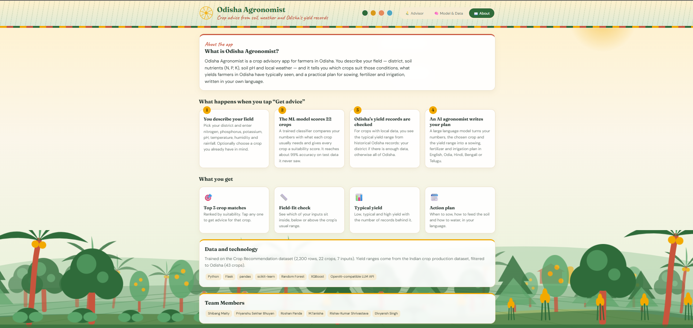

# 🌾 Odisha Agronomist

**Crop advice from soil, weather and Odisha's yield records.**

Odisha Agronomist is a crop advisory web app for farmers in Odisha. You describe your field (district, soil nutrients N, P, K, soil pH and local weather) and the app tells you which crops suit those conditions, what yields farmers in Odisha have typically seen, and a practical sowing, fertilizer and irrigation plan in your own language.

**🔗 Live app:** https://odisha-agronomist-mm4j.onrender.com/

_It runs on Render's free plan, so the first visit after a quiet period can take 30 to 60 seconds to wake up._

## 📸 Screenshots

### 1. Advisor
Enter the district, soil and weather values to get crop matches, a yield range and the action plan.



### 2. Model & Data
Test accuracy, Random Forest vs XGBoost, what drives the prediction and the score per crop.



### 3. About
How the app works, the data behind it and the team members.



## ✨ Features

- **Top 3 crop matches:** A trained classifier scores 22 crops for your field. Tap any crop to get advice for it.
- **Field-fit check:** Shows whether each input is in, below or above the crop's usual range.
- **Typical yield:** Low, typical and high yield from historical Odisha records (district level where there is enough data, otherwise all of Odisha), with the record count and confidence.
- **AI action plan:** An LLM writes a sowing schedule, fertilizer management and irrigation strategy in English, Odia, Hindi, Bengali or Telugu.
- **Model & Data tab:** Test accuracy, Random Forest vs XGBoost comparison, feature importance and per-crop F1 scores.
- **Themed UI:** Four themes (Monsoon, Harvest, Sunrise, Chilika) and an animated farm scene.

## 🔄 How it works

1. You pick your district and enter N, P, K, pH, temperature, humidity and rainfall (optionally a crop to check).
2. The ML model scores all 22 crops (about 99% accuracy on held-out test data).
3. Odisha yield records are checked for a typical yield range.
4. An LLM turns your values, the chosen crop and the yield range into a plan in your language.

## 🧰 Tech stack

Flask · pandas · scikit-learn · Random Forest · XGBoost · OpenAI-compatible LLM API (xAI Grok) · HTML, CSS and JavaScript (single-page frontend served as a Jinja template)

## 📊 Data

- **Crop Recommendation dataset:** 2,200 rows, 22 crops, 7 inputs, used to train the classifier.
- **Indian crop production dataset:** filtered to Odisha (29,625 rows, 30 districts, 43 crops), used for yield ranges.
- No values in the source datasets were added or changed.

## 🚀 Run locally

```bash
# 1. Clone
git clone https://github.com/shibangmaity/Odisha_Agronomist.git
cd Odisha_Agronomist

# 2. Install dependencies
pip install -r requirements.txt
```

Create a file named `.env` next to `app.py` (it is git-ignored) with your key. The app accepts any one of these:

```
XAI_API_KEY=your_key
# or GROQ_API_KEY=your_key
# or OPENAI_API_KEY=your_key
```

```bash
# 3. Start the app
python app.py
```

Open `http://localhost:5000` in your browser. Without a key, crop matches and yield ranges still work; only the AI action plan needs it.

> The page must be opened through Flask. If you open `index.html` directly in the browser, the district list will show raw template text like `{{ d.title() }}`.

## 📁 Project structure

```
├── app.py                          # Flask app and API routes
├── templates/
│   └── index.html                  # Frontend (Advisor, Model & Data, About)
├── models/
│   ├── crop_model.pkl              # Random Forest crop classifier
│   └── yield_stats.pkl             # Yield ranges per crop and district
├── data/processed/                 # Odisha yield data and crop recommendation data
├── screenshots/                    # Images used in this README
├── odisha_crop_advisory_v5.ipynb   # Notebook that builds the two .pkl files
├── requirements.txt
└── README.md
```

## ☁️ Deploy on Render

- Build command: `pip install -r requirements.txt`
- Start command: `gunicorn app:app --workers 1 --timeout 300`
- Environment variable: `XAI_API_KEY` (your key, never commit it)

## ⚠️ Good to know

- Crop scores use soil and weather values only. The district is used for the yield range and the AI's local advice.
- The model learned from a general crop dataset (synthetic Kaggle data), so treat scores and the 99% accuracy as guidance and a demonstration figure, not a guarantee in the field.
- Some crops, like mango and coconut, have no Odisha yield records, so no yield range is shown. Crops with few records (for example cotton) have low confidence.
- Yield values in the source data mix units (for example rice at 150+ t/ha, mostly from 2016 onward), so the app shows a typical range (25th–75th percentile) instead of a prediction. Implausible rows are left out only when the range is calculated, never from the dataset.
- Always confirm fertilizer doses with your local Krishi Vigyan Kendra (KVK) before buying inputs.

## 👥 Team Members

Shibang Maity · Priyanshu Sekhar Bhuyan · Roshan Panda · M. Tanisha · Rishav Kumar Shrivastava · Divyansh Singh

## 📚 Data sources

- Indian crop production yield dataset (Kaggle)
- Crop Recommendation dataset (Kaggle)
